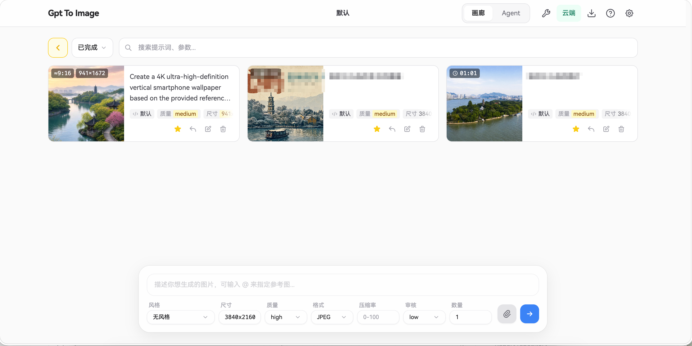
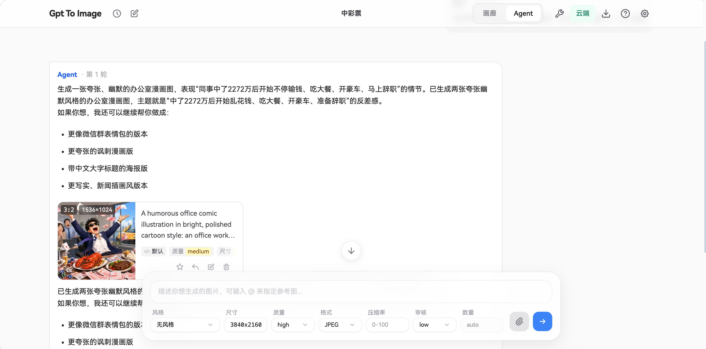
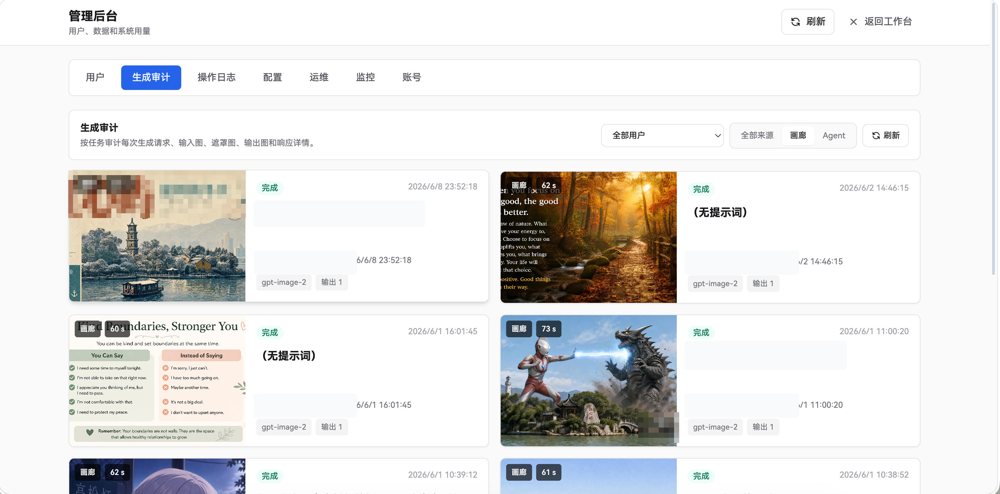
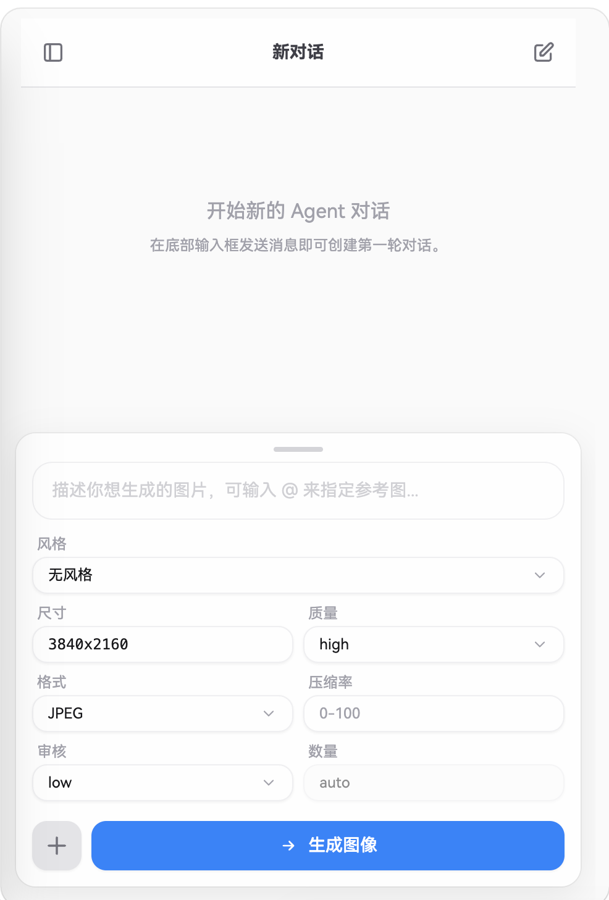

<div align="center">

# 2Image

**面向个人与团队的自托管 AI 图片工作台**

[](https://github.com/rongwei-lab/2image/stargazers)
[](https://github.com/rongwei-lab/2image/network/members)
[](https://github.com/rongwei-lab/2image/blob/main/LICENSE)
[](https://react.dev/)
[](https://www.typescriptlang.org/)

[项目主页](https://github.com/rongwei-lab/2image) · [提交问题](https://github.com/rongwei-lab/2image/issues) · [查看发布版本](https://github.com/rongwei-lab/2image/releases)

</div>

2Image 是一个可自行部署的 AI 图片工作台，适合将图像生成、编辑、Agent 协作与历史资料沉淀在自己的浏览器或服务器中。

- **浏览器本地模式**：数据保存在浏览器 IndexedDB，适合个人使用和快速试验。
- **云端工作台模式**：使用 PostgreSQL、MinIO/S3 与内置 API 服务，提供账号、多用户、统一配置、配额和审计能力。
- **模型与服务商自选**：接入 OpenAI 兼容接口、Responses API、fal.ai 或按 JSON 导入自定义 HTTP 服务商。

> 2Image 不提供模型额度或 API Key。实际能否生成、支持的尺寸、质量、输出数量与功能取决于你接入的服务商、账户订阅和模型权限；界面中的“请求参数”与“实际参数”可能不同，以服务端响应为准。

## 功能概览

| 范围 | 能力 |
| --- | --- |
| 图像工作台 | 文生图、图生图、参考图、遮罩编辑、批量生成、透明背景后处理、历史图复用 |
| Agent 模式 | 多轮对话、图片引用、分支与重生成、原生 Responses API 或 Hybrid 模式、批量图片工具 |
| API 接入 | OpenAI 兼容 Images API、Responses API、fal.ai、自定义同步或异步 HTTP 服务商 |
| 参数追踪 | 展示请求参数、模型改写后的提示词、实际尺寸、质量、耗时与原始任务信息 |
| 数据管理 | 画廊、收藏、筛选、批量操作、ZIP 导出导入、跨设备云端同步 |
| 云端管理 | 管理员后台、注册审批、用户启停、任务与存储配额、平台 API 策略、生成审计、孤儿文件扫描 |
| 部署运维 | Docker Compose 一键部署、PostgreSQL 持久化、MinIO/S3 对象存储、健康检查和代理配置 |

## 界面预览

<div align="center">
  
  <p>画廊工作台</p>
</div>

<div align="center">
  
  <p>桌面端 Agent</p>
</div>

<div align="center">
  
  <p>管理员后台与生成审计</p>
</div>

<div align="center">
  
  <p>移动端 Agent</p>
</div>

## Docker 自托管

### 1. 准备环境

需要 Docker Engine 与 Docker Compose v2。生产环境建议仅公开 Web 端口，并通过反向代理提供 HTTPS。

```bash
git clone https://github.com/rongwei-lab/2image.git
cd 2image
cp .env.example .env
```

编辑 `.env`，至少设置项目名称、仓库地址、管理员账户和安全密钥。生产环境不要使用默认密钥或默认管理员密码。

```dotenv
VITE_APP_NAME="2Image"
VITE_APP_AUTHOR_NAME="@rongwei-lab"
VITE_APP_REPOSITORY_URL="https://github.com/rongwei-lab/2image"
VITE_APP_ISSUES_URL="https://github.com/rongwei-lab/2image/issues"
VITE_APP_RELEASES_URL="https://github.com/rongwei-lab/2image/releases/latest"
VITE_APP_RELEASE_API_URL="https://api.github.com/repos/rongwei-lab/2image/releases/latest"

WEB_PORT="8091"
API_HOST_BIND="127.0.0.1"
MINIO_HOST_BIND="127.0.0.1"

SESSION_SECRET="替换为至少 32 位随机字符串"
KEY_ENCRYPTION_SECRET="替换为至少 32 位随机字符串"
ADMIN_EMAIL="admin@example.com"
ADMIN_PASSWORD="替换为强密码"
ALLOW_INSECURE_DEFAULTS="false"

S3_ACCESS_KEY_ID="替换为 MinIO 管理账号"
S3_SECRET_ACCESS_KEY="替换为 MinIO 强密码"
```

可用下列命令生成随机密钥：

```bash
openssl rand -hex 32
```

`KEY_ENCRYPTION_SECRET` 用于加密云端保存的平台 API Key。它一旦丢失，已有加密内容将无法恢复；请与 `.env` 一起安全备份。

### 2. 构建并启动

```bash
npm ci
npm run docker:prepare
docker compose up -d --build

docker compose ps
curl http://127.0.0.1:8091/api/health
```

健康检查返回 `{"ok":true}` 后，在浏览器访问 `http://服务器地址:8091`。用 `ADMIN_EMAIL` 和 `ADMIN_PASSWORD` 登录即可使用管理员账户。

> `npm run docker:prepare` 会生成前端构建产物、服务端打包文件与 Docker 构建缓存；首次部署和每次升级后都应执行。

### 3. 反向代理部署

推荐只对外开放 Web 服务端口，将 API 和 MinIO 绑定到回环地址：

```dotenv
WEB_PORT="8091"
API_HOST_BIND="127.0.0.1"
MINIO_HOST_BIND="127.0.0.1"
```

通过 Nginx、Caddy 或其他反向代理将 HTTPS 域名转发到 `127.0.0.1:8091`。当前 Compose 默认 `COOKIE_SECURE="false"`；确认站点仅通过 HTTPS 访问后，可将 `docker-compose.yml` 中该值改为 `"true"`。请确保反向代理也正确转发 WebSocket 和流式响应。

### 4. 容器访问模型 API

服务器无法直连模型服务时，可在 `.env` 配置代理：

```dotenv
APP_HTTP_PROXY="http://host.docker.internal:1082"
APP_HTTPS_PROXY="http://host.docker.internal:1082"
APP_ALL_PROXY=""
```

Linux Docker 访问宿主机代理时，`host.docker.internal` 不一定默认可用。可改为宿主机在 Docker 网桥可访问的 IP，或在 Compose 中额外配置 host-gateway 映射。若使用直连，请保留或按网络环境调整 `DOCKER_DNS_PRIMARY` 与 `DOCKER_DNS_SECONDARY`，避免代理软件的 fake-ip DNS 导致容器连接超时。

## 使用说明

### 选择运行模式

- **本地模式**：不登录即可在浏览器中使用。任务、图片、配置和 Agent 对话保存在当前浏览器；适合单用户和试验。
- **云端模式**：注册或登录后，任务、图片和会话保存在服务器。适合多设备和多人协作。
- **平台托管 API**：管理员可以在后台统一配置服务商和模型，并锁定 Agent 策略；普通用户无需保存平台 API Key。

### 配置图像与 Agent API

在配置页新建或切换服务商：

1. 对于图像生成，选择 Images API、Responses API、fal.ai 或自定义服务商，并填入地址、Key 和模型。
2. Agent 原生模式需要兼容 Responses API 的文本模型和图片工具。
3. Hybrid 模式可分别选择对话模型与图像生成模型，适合不支持 `image_generation` 工具的服务商组合。
4. 自定义服务商可导入 JSON 配置；同步和异步任务都可接入。

服务商返回“参数不支持”“尺寸被调整”“质量与请求不一致”时，通常不是 2Image 前端擅自修改：部分兼容接口会接受字段但忽略它们，或由模型按其能力自动降级。请先核对模型名称、账户权限、服务商文档及任务详情中的实际参数。

### 管理员后台

管理员登录后可从页面右上角进入 `/admin`。后台可管理：

- 平台 API 与 Agent 策略，含连通性测试和密钥加密保存。
- 用户注册审批、角色、禁用状态、会话撤销，以及任务和存储配额。
- 生成任务与图片审计，可按上下文查看，并对 Agent 历史任务发起重新生成。
- 操作审计、对象存储统计和孤儿文件清理。

### 数据存储与备份

云端模式中：

- PostgreSQL 保存用户、设置、任务、Agent 对话、审计记录和元数据。
- MinIO/S3 保存原图、缩略图、参考图与遮罩文件。
- Docker Compose 使用 `postgres-data` 与 `minio-data` 命名卷持久化数据。

升级或维护时，**不要执行** `docker compose down -v`，该命令会删除命名卷中的数据库和对象存储数据。建议定期备份 PostgreSQL、MinIO 数据卷、`.env` 与 `KEY_ENCRYPTION_SECRET`。

## 升级

2Image 使用 `2image-vX.Y.Z` 形式的 Git 标签。升级前先备份数据库、对象存储和 `.env`。

```bash
git fetch origin --tags
git pull --ff-only
npm ci
npm run docker:prepare
docker compose up -d --build

docker compose ps
curl http://127.0.0.1:8091/api/health
```

查看发布说明请访问 [Releases](https://github.com/rongwei-lab/2image/releases)。若自定义过 `.env`，升级后请对照新的 `.env.example` 补充新增配置项。

## 本地开发

```bash
npm ci
npm run dev
```

常用检查命令：

```bash
npm test
npm run build
npm run check:server
npm run docker:prepare
```

项目使用 React 19、Vite、TypeScript、Zustand 与 Tailwind CSS。前端源码位于 `src/`，云端 API 位于 `server/`，Docker 部署文件位于 `deploy/` 与 `docker-compose.yml`。

## 安全提示

- 不要把 `.env`、API Key、数据库备份或 MinIO 访问密钥提交到 Git。
- 生产环境必须修改 `SESSION_SECRET`、`KEY_ENCRYPTION_SECRET`、`ADMIN_PASSWORD` 与 MinIO 默认凭据，并设置 `ALLOW_INSECURE_DEFAULTS="false"`。
- 仅开放必要端口；管理后台和对象存储控制台应仅限可信网络访问。
- 服务商连通不代表模型可用。HTTP 连接成功但请求被拒绝时，应检查 API Key、订阅、模型白名单和账户额度。

## 许可证与致谢

本项目采用 [MIT License](LICENSE)。

2Image 基于 [CookSleep/gpt_image_playground](https://github.com/CookSleep/gpt_image_playground) 持续演进。感谢上游项目及其贡献者的开源工作。
